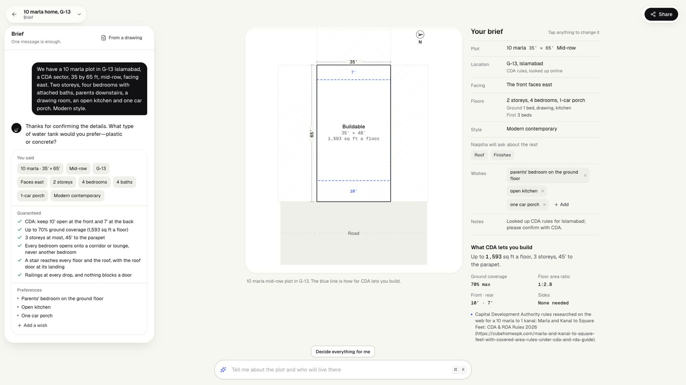
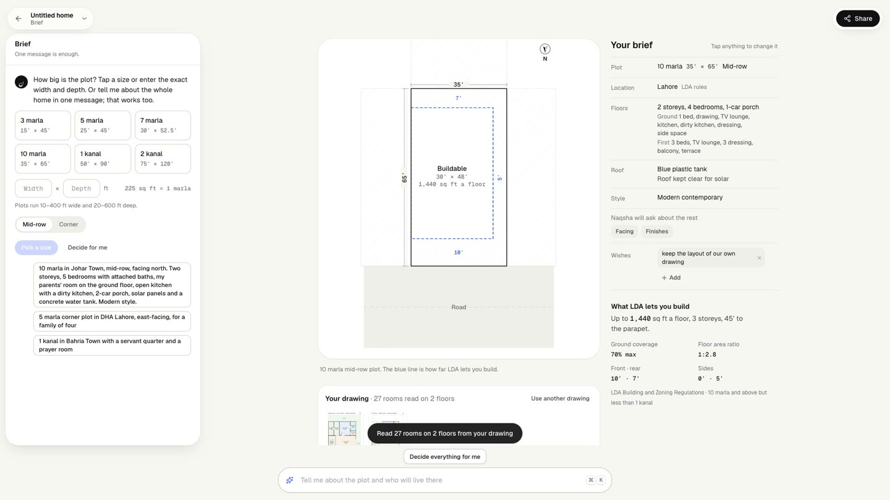
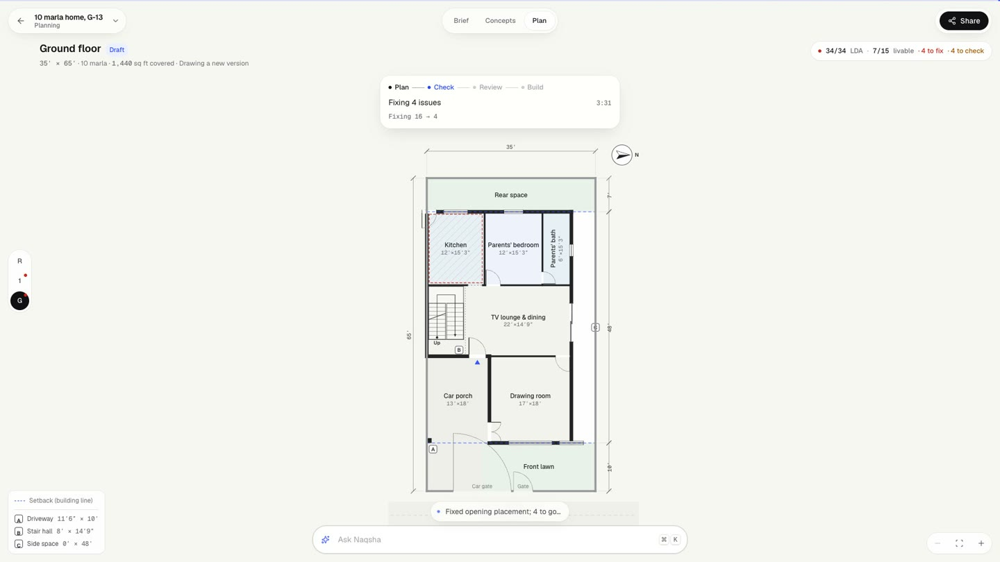
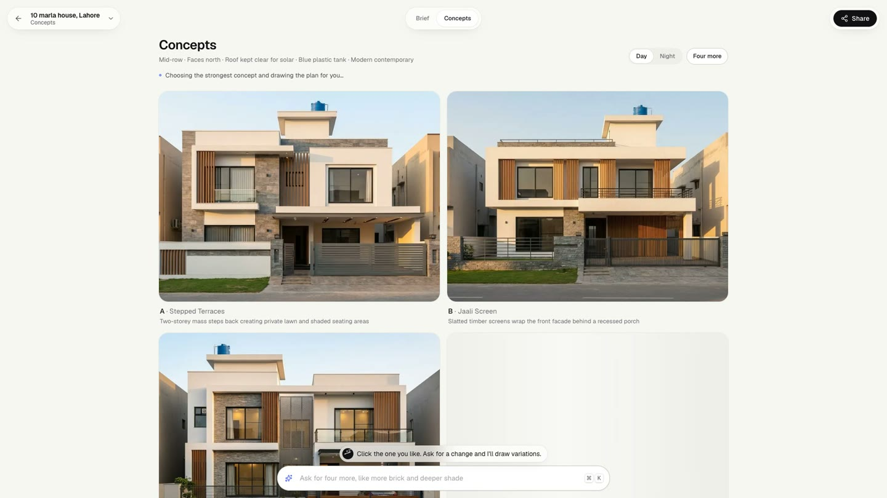
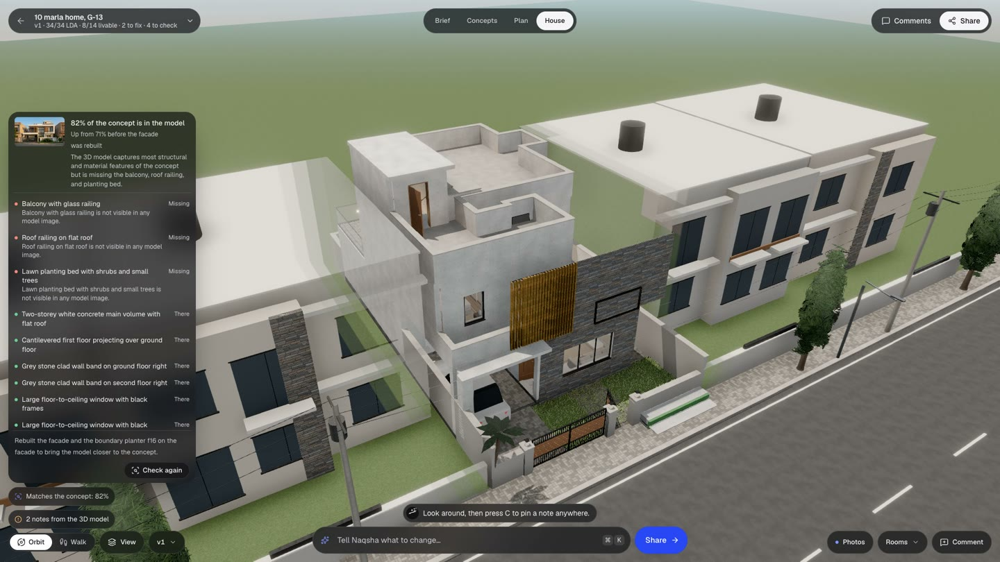
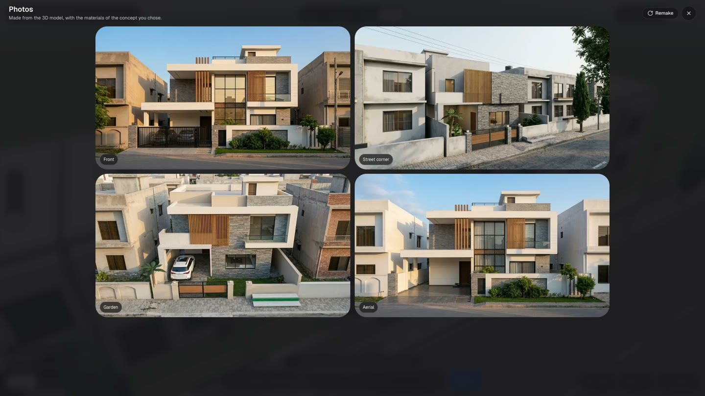
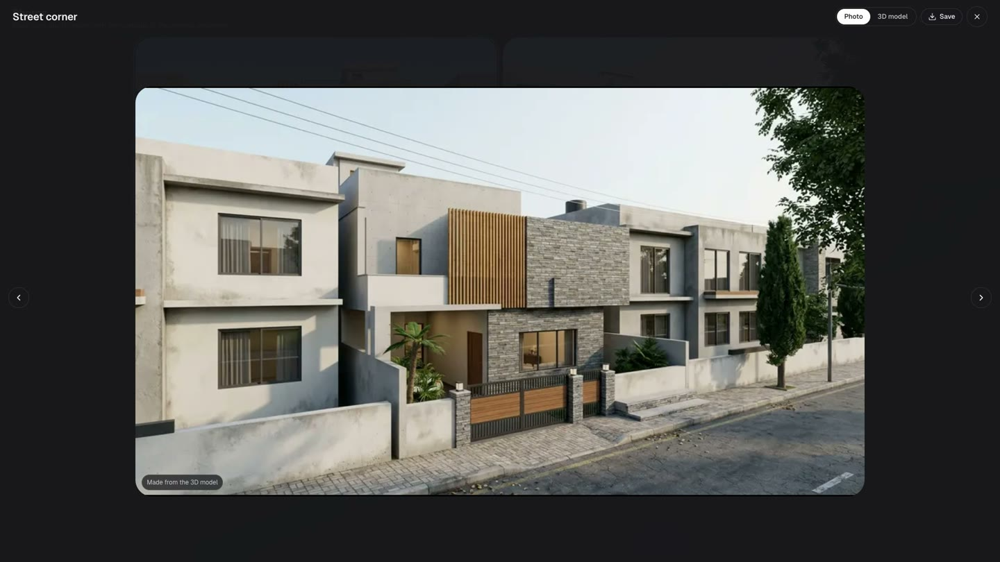
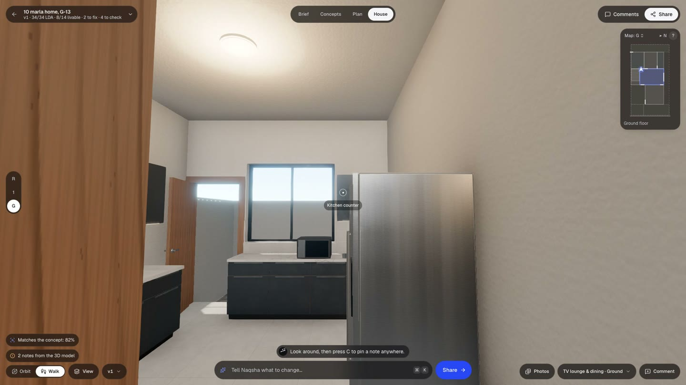

# Naqsha · نقشہ

**Describe a home in plain words, or upload a drawing of one, and get a floor plan checked against your city's building rules, a 3D model you can walk through, and photographs of the house from every angle. Designed by NVIDIA Nemotron agents on Nebius Token Factory.**

**Live demo:** https://naqsha-963839790554.us-central1.run.app — open a sample home, or start your own. No account needed.
**Video (under 3 min):** _link added on submission_
**License:** AGPL-3.0

*Naqsha* (نقشہ) is what families in Pakistan call a house plan. Most homes there start as a contractor's sketch and weeks of back-and-forth with a draftsman, with nobody checking the bylaws until the plan is refused. Naqsha does that work in minutes, with agents that check their own drawings against the rules.

## What it does

1. **Brief.** One message is enough: *"10 marla in Johar Town, 4 bedrooms, parents downstairs, modern."* A tool-using setup agent (Nemotron 3 Super) records the brief and asks only what's missing.
2. **Or upload your drawing.** A photo of an architect's plan or a sketch on paper. **Nemotron 3.5 Super VL** reads it room by room (names, sizes, positions, doors, windows) and the architect plans *from* that layout, changing only what the rules need.
3. **Rules for your city.** Lahore's LDA regulations ship as a hand-verified rule pack. For any other city (Islamabad, Karachi, Dubai…) the agent uses **Tavily** to search and extract the authority's residential bylaws, and **Nemotron 3 Ultra** turns the pages into a rule pack (setbacks, coverage, FAR, height and storeys by plot size), each band citing its sources. The plan is then checked against it.
4. **Concepts.** Four exteriors, by day and by night. Once a house is designed, concepts are drawn *from its own front elevation and floor plan*, so the photograph shows the house on the plan.
5. **Plan.** Nemotron 3 Ultra drafts three plans in parallel, the rules engine scores them (LDA bylaws + livable-home rules), and a **tool-using fixer agent** repairs the best one edit by edit: every edit is dry-run against the rules and kept only if the plan gets better. On a 10 marla brief: 18 failures → 0 in about four minutes.
6. **House.** Nemotron 3 Ultra writes the 3D model as code (`design.js`) against our House SDK (three.js), section by section. The chosen concept is first read by the vision model into a **feature checklist** (F1…F20: cladding, fins, balconies, railings, canopies, gate…) that the 3D code must build.
7. **Match check.** Nemotron VL compares the 3D model's front view with the concept, feature by feature, and the features that are missing go back to Nemotron 3 Ultra, which rebuilds only those facade sections.
8. **Photos from every angle.** The app captures the 3D model from the road, the street corner, the garden and the air, and an image model turns each capture into a photograph without moving a wall. Every angle shows the same house.
9. **Walk, comment, revise.** Walk through in first person, pin a comment on any wall, and a revision agent (Google ADK + Nemotron 3 Ultra, 9 tools) applies the changes, re-checks the rules and answers each comment.

## Screens

Captured from the live app with Playwright (`submission/capture/capture.mjs`) on 28 Oct 2026.

| | |
|---|---|
|  |  |
| **Rules for your city.** One message about a plot in G-13 Islamabad; the CDA rules were looked up with Tavily and cited. | **Start from a drawing.** Nemotron VL read 27 rooms on 2 floors from two uploaded sheets. |
|  |  |
| **Plan.** The fixer agent works down the failures, edit by edit ("Fixing 16 → 4"). | **Concepts.** Drawn from the family's own layout: porch on the right, drawing room front left. |
|  |  |
| **Match.** 82% of the concept's features in the 3D model, up from 71% before the facade refit. | **Photos.** From the road, the street corner, the garden and the air, each made from the model. |
|  |  |
| **Street corner.** The image model keeps the model's geometry and camera. | **Walk.** First person, room by room, with a minimap. |

## How Nemotron and Nebius are used

Every text and vision model call runs on **Nebius Token Factory** (OpenAI-compatible API).

| Agent / step | Model on Token Factory | How |
|---|---|---|
| Setup agent (brief chat, rule research tool) | `nvidia/nemotron-3-super-120b-a12b` | Google ADK agent via LiteLLM, 6 tools, reasoning off for fast turns |
| Plan drafts (×3 in parallel) | `nvidia/Nemotron-3-Ultra-550b-a55b` | JSON mode, reasoning off (~25 s per draft) |
| Plan fixer agent | `nvidia/Nemotron-3-Ultra-550b-a55b` | native tool calling with reasoning on: `get_elements`, `check_edits`, `apply_edits`, `finish` |
| Rule pack from web pages | `nvidia/Nemotron-3-Ultra-550b-a55b` | reads Tavily search + extract results, writes cited rule bands |
| 3D model as code (`design.js`) | `nvidia/Nemotron-3-Ultra-550b-a55b` | streamed sections, built live in the browser |
| Reading uploaded drawings | `nvidia/Nemotron-3.5-Super-VL` | room-by-room transcription with boxes on the sheet |
| Concept → feature checklist, 3D ↔ concept match | `nvidia/Nemotron-3.5-Super-VL` | image in, structured JSON out |
| Architect's review of its own drawings | `nvidia/Nemotron-3.5-Super-VL` | the floor plans are drawn as images and critiqued |
| Revision agent | `nvidia/Nemotron-3-Ultra-550b-a55b` | Google ADK agent via LiteLLM, 9 tools |
| Fallbacks | Ultra → Super → Nemotron 3.5 Lightning | on 429/5xx |

Image generation (concepts, photos of the model) uses Gemini image models on Vertex AI, because Token Factory doesn't serve image generation. Web research uses the **Tavily** Search and Extract APIs at runtime.

## Architecture

```
React SPA (Vite, three.js r186, react-three-fiber, three-mesh-bvh)
        │  REST + Server-Sent Events
Cloud Run · FastAPI (serves the SPA and the API)
  ├─ Setup agent ........ Google ADK + LiteLLM → Nemotron 3 Super (Token Factory); tools incl. research_local_rules
  ├─ Rule research ...... Tavily search + extract → Nemotron 3 Ultra → cited rule pack → rules engine
  ├─ Drawing import ..... Nemotron 3.5 Super VL reads sheets → layout in plot feet → brief
  ├─ Architect .......... Nemotron 3 Ultra: 3 drafts ⟶ rules engine ⟶ fixer agent (tool calls) ⟶ VL self-review
  │                        ⟶ concept feature checklist ⟶ streamed design.js
  ├─ Match + photos ..... Nemotron VL feature match ⟶ Ultra refits facade sections; image model renders 3D captures
  ├─ Reviser ............ Google ADK + LiteLLM → Nemotron 3 Ultra, 9 tools
  ├─ Rules engine ....... deterministic Python: LDA 2026 rules from LDA's official PDFs + livable-home rules
  ├─ Firestore / Cloud Storage
Nebius Token Factory (all text and vision models) · Tavily · Gemini image models (Vertex AI)
```

Code map: `api/app/llm.py` (the Token Factory adapter), `api/app/agents/` (`architect.py`, `fixer.py`, `research.py`, `importer.py`, `views.py`, `setup_agent.py`, `reviser_adk.py`), `api/app/compliance/` (the rules engine), `contracts/` (plan schema, House SDK API), `web/src/` (the app, the 3D engine and viewer).

## Run locally

Prerequisites: Node 22, Python 3.13, `uv`, a Nebius Token Factory API key, a Tavily API key, and a Google Cloud project with Firestore, Cloud Storage and Vertex AI (for images).

```bash
cp .env.example .env    # then fill in NEBIUS_API_KEY, TAVILY_API_KEY, GOOGLE_CLOUD_PROJECT
cd api && uv sync && cd ..
zsh scripts/dev-api.sh                 # API on :8080
cd web && npm ci && npx vite           # app on :5173
```

To work on the UI without any backend: `cd web && VITE_MOCK=1 npx vite`.

Tests: `cd api && uv run pytest`.

## Deploy

`scripts/push-secrets.sh` copies the two API keys from `.env` into Secret Manager; `scripts/deploy.sh` builds and deploys to Cloud Run (scales to zero, keys from Secret Manager).

## Built during the hackathon

Naqsha was started in October 2026, inside the Nebius x NVIDIA Global AI Hackathon's submission period, and prototyped on Gemini first:
- every text and vision agent moved to NVIDIA Nemotron on Nebius Token Factory, with a new Token Factory adapter;
- a new tool-using **plan fixer agent** and parallel drafting;
- **start from your own drawing** (Nemotron VL drawing reader);
- **rules for any city**, researched with Tavily;
- concepts drawn **from the designed house**, a **concept-to-3D feature checklist and match check** with automatic facade refits, and **photos from every angle** made from the 3D model.

## Disclaimer

Naqsha produces concept designs and a regulation pre-check. Building plans must still be signed by a registered architect, and researched rule packs must be confirmed with the authority.

## License

Copyright © 2026 Pivot Analytix (Abdullah Moazzam, Saad Wali Muhammad Joiya, Usama Bin Maalik). Licensed under the GNU Affero General Public License v3.0; see [LICENSE](LICENSE).
